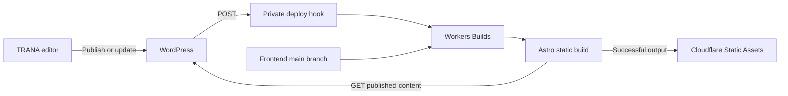

# Architecture and publishing

Working proposal · 13 November 2026. These are requirements for implementation, not configured services.

## Content flow

1. **WordPress owns content.** Use its native REST API for posts, pages and media. Public reads currently work without credentials. No GraphQL or headless plugin is needed for the initial published-content pilot. [Astro's WordPress guide](https://docs.astro.build/en/guides/cms/wordpress/).
2. **Astro owns presentation.** A content adapter will validate responses, normalize titles and links, and produce static routes. It must handle pagination, resolve media, and fail on missing required pilot content. Do not silently substitute an empty news list. [WordPress pagination](https://developer.wordpress.org/rest-api/using-the-rest-api/pagination/).
3. **Imported HTML needs a policy.** Review `content.rendered` before rendering it: allow supported markup, exclude executable content, and replace layout tables or theme-dependent blocks with semantic components. Heading levels and image alternatives require editorial review. Copying the old theme's HTML/CSS is not the proposed migration.

## Publishing events

WP Webhooks is the proposed sender. Configure the installed version against this event contract; do not rely on a trigger's name alone.

| WordPress event | Required frontend behavior |
| --- | --- |
| First publication, including a scheduled post becoming public | Rebuild the list and article route |
| Edit a published post or page | Rebuild the affected content |
| Move published content to draft, private or trash; delete it | Rebuild and remove it from public output |
| Change a slug | Update the URL map and preserve an agreed redirect |
| Change a referenced image, caption or alternative | Rebuild the content that uses it |
| Save a draft, revision or autosave | No production rebuild solely for that save |

The plugin documents post-create, update and delete triggers. Its create trigger has an initial-status filter; this does not establish complete coverage for later withdrawal or republication. Verify event filters, retries and any edition requirements on staging. [Plugin](https://wordpress.org/plugins/wp-webhooks/), [create-trigger source](https://plugins.svn.wordpress.org/wp-webhooks/trunk/core/includes/integrations/wordpress/triggers/post_create.php).

## Deployment and failures

1. Connect the frontend repository to Workers Builds and create a hook for `main` in **Settings → Builds → Deploy Hooks**. The POST starts a build; its success response is not proof that the new content is live. Keep the hook URL in private configuration, outside Git and browser code. [Cloudflare Deploy Hooks](https://developers.cloudflare.com/workers/ci-cd/builds/deploy-hooks/).
2. Astro fetches content during the build. The hook payload is not the content source. Editors should expect publication after a successful deployment, not immediately after pressing Publish.
3. On API or build failure, retain the last good deployment, report the failure and support a manual retry. Test rapid edits during an active build; the final website must contain the newest published state. Define an urgent-removal procedure because a failed rebuild can leave withdrawn material in the previous deployment.

## CMS origin before domain cutover

The current API and media use `www.tranandorra.org`, also the public website's hostname. Pointing that hostname at Astro without a routing plan would break WordPress access or make future builds fetch the frontend instead of the API.

Before launch, choose a stable WordPress origin: a dedicated CMS hostname or explicit routing to the WordPress host. Preserve admin/login, REST endpoints and uploads. Review absolute content links, image URLs, WordPress redirects and frontend canonicals together. No hostname or DNS change is authorized by this planning document.

Authenticated draft previews, including any use of Palasthotel's [Headless plugin](https://wordpress.org/plugins/headless/), remain outside the first pilot.
